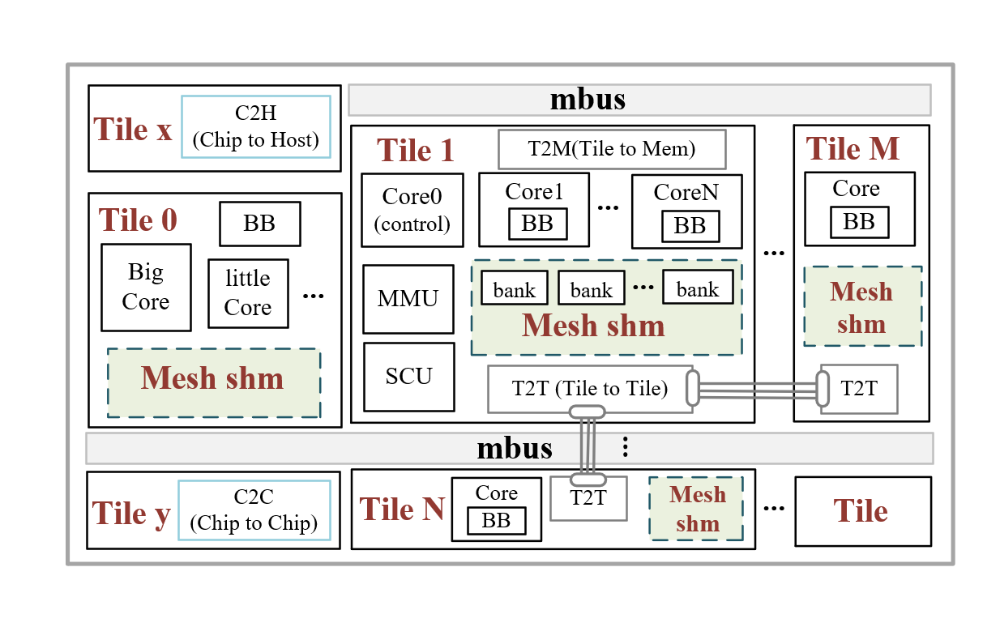
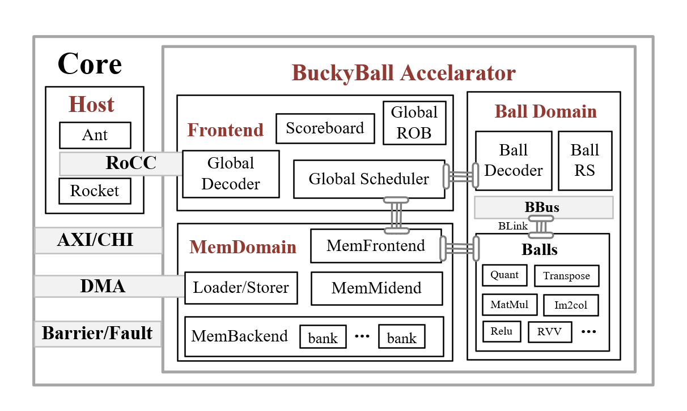

# Buckyball design overview

Buckyball separates shared infrastructure from concrete instances. The mainline defines interfaces, the compiler, simulators, runtime, and verification environment. `examples/` contains buildable Balls, Cores, and Chips that select and implement those shared pieces.

## Repository layers

| Layer | Path | Responsibility |
| --- | --- | --- |
| Shared hardware | `arch/` | Frontend, MemDomain, BallDomain, bank and interconnect framework |
| Developer tools | `bbdev/` | Unified CLI, HTTP API and MCP entry points |
| Simulation | `bebop/` | BEMU, Verilator nodes, runtime loading and traces |
| Software stack | `stack/` | Compiler, runtime, platforms, models, serving and simulations |
| Instances | `examples/` | Ball, Core and Chip implementations, configs and workloads |
| Tests and verification | `bb-tests/`, `verify/` | C/MLIR workloads, regression manifests and UVM environments |

`examples/balls/<ball>` owns a Ball's RTL parameters, functional model, ISA wrappers, workloads and verification. `examples/cores/<core>` owns CPU, Frontend, BallDomain, MemDomain and the Core compiler package. `examples/chips/<chip>` owns tile configuration, simulation targets, kernel workloads and regression manifests.

Chip configuration starts at `examples/chips/<chip>/configs/chip.toml`. The generated files under `configs/generated/` are outputs of the configuration install step and should not be edited by hand.

## Design principles

- Ball is the boundary for a compute extension. Shared domains provide scheduling, memory and control interfaces.
- Bank is the common unit for memory operations and dependency tracking.
- The same interfaces cover a single Core, multiple Cores in a Tile, and multiple Tiles on a chip.
- A capability needed by several instances belongs in the mainline; an instance should provide its own configuration and implementation.

## Hardware view

The Tile-level diagram shows `mbus`, `T2M`, `T2T`, and the chip boundaries. The Core-level diagram shows how RoCC, Frontend, MemDomain, BallDomain, and Balls fit together.

For the hardware view, see the [main architecture overview](../../zh/设计文档/主线架构/0.0.1/Overview/Overview.md). For setup and the first workload, see the [repository setup guide](../../zh/教程/仓库概览与环境搭建.md).
