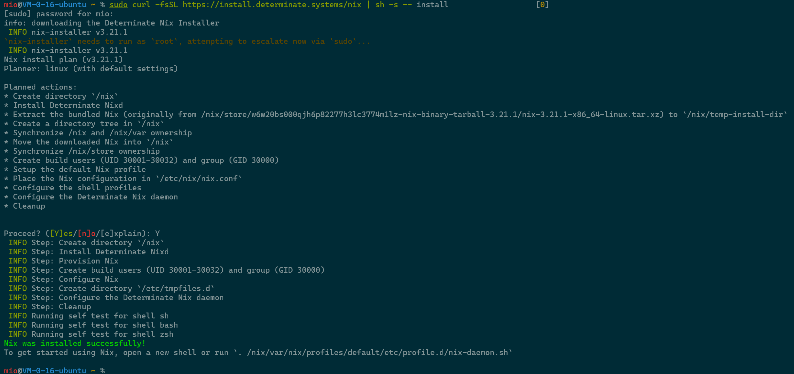
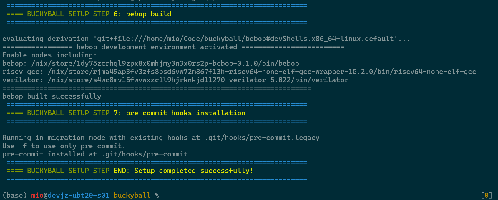
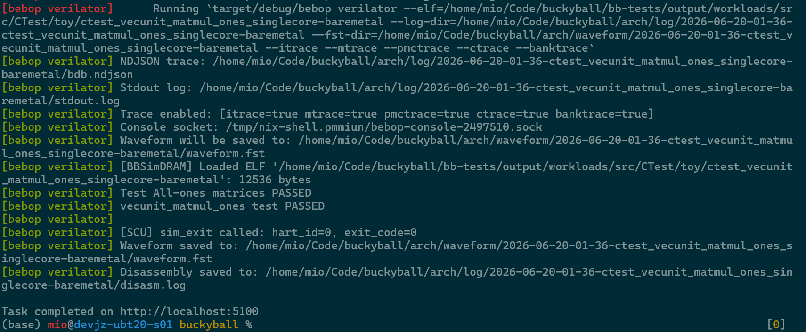

# 仓库概览与环境搭建

## Buckyball 是什么

Buckyball 是一个面向领域专用架构（DSA）的软硬件框架。它把指令接入、调度、bank 访存、编译、模拟、验证和运行时这些共性工作放进主线，让具体项目集中实现自己的 Core、Ball 和 Chip。

仓库按职责分层：

```text
arch/       共享硬件框架：Frontend、MemDomain、BallDomain、bank 和互连
bbdev/      统一开发者入口：CLI、HTTP API、MCP
bebop/      BEMU、Verilator 运行节点和 trace
stack/      compiler、runtime、platforms、models、serving、sims
examples/   Ball、Core、Chip 的实例和配置
bb-tests/   CTest、MLIRTest、kernel、workload 和回归输出
verify/     共享 UVM 环境以及 IP/Ball 验证
```

实例之间的关系是：Ball 接入 Core 的 BallDomain，Core 被 Chip 的 Tile 配置引用，Chip 再由 BEMU、Verilator 或 FPGA 工具运行。芯片配置从 `examples/chips/<chip>/configs/chip.toml` 开始；`configs/generated/` 是配置安装产生的文件，不应直接编辑。

## 环境构建

Buckyball 使用 Nix Flake 管理编译器、RISC-V 工具链、Verilator、CMake、Ninja、Rust 和仿真依赖。首次安装需要网络访问 GitHub，并建议使用 Linux 环境。

### 1. 安装 Nix

可以使用官方安装方式，也可以使用 Determinate Systems 安装器。安装后确认 `nix --version` 可用，并启用 flakes。

```bash
curl -fsSL https://install.determinate.systems/nix | sh -s -- install
```

安装完成后，重新打开终端并确认 `nix --version` 可用。



### 2. 初始化仓库

```bash
git clone https://github.com/DangoSys/buckyball.git
cd buckyball
./scripts/nix/build-all.sh
```

`build-all.sh` 会进入 Nix 环境，初始化 submodule，安装 `bbdev`，构建 compiler、RTL 预编译产物、workload、Bebop 和验证环境，并安装项目 MCP。看到 setup completed 后，说明基础环境已经完成。首次执行时间较长；后续进入环境只需要：

```bash
nix develop
```



如果只想执行某一步，可以用脚本的 `-o` 选项，例如只安装 bbdev：

```bash
./scripts/nix/build-all.sh -o 1
```

### 3. 构建一个 Chip 的 workload

先安装配置，再构建 toy 的 workload：

```bash
bbdev config --install
bbdev workload --build '--chip toy'
```

生成的 ELF 位于 `bb-tests/output/toy/workloads/src`。CTest 和 MLIRTest 分别用于验证手写 C 指令调用和编译器 lowering；两者都通过同一个 workload 构建入口生成。

### 4. 先跑 BEMU，再跑 Verilator

BEMU 只检查指令和功能模型，适合快速迭代；Verilator 执行生成的 RTL，用于检查时序、握手和 bank 访问。先用 BEMU 跑一个已有的 toy 用例：

```bash
bbdev bebop-bemu --sim '--chip toy --binary toy-toy-ctest-relu_i32_16x16_test-baremetal'
```

需要对照 RTL 时执行一条龙流程：

```bash
bbdev bebop-verilator --run '--chip toy --binary toy-toy-ctest-relu_i32_16x16_test-baremetal --no-wave'
```

第一次运行会生成 Verilog 并编译仿真器，耗时会更长。命令返回成功且日志中显示 workload 通过，说明安装和最小运行链路都正常。



想保留波形和 trace 时去掉 `--no-wave`，并增加 `--itrace`、`--mtrace`、`--pmctrace`、`--ctrace` 或 `--banktrace`。日志写入 `log/`，波形位于对应日志目录的 `waveform/`。

## 先理解一次完整运行

第一次运行时，可以把一个 workload 看成四个阶段：

```text
配置安装 → workload 编译 → BEMU 功能模拟 → Verilator RTL 仿真
```

`bbdev config --install` 读取 `examples/chips/toy/configs/chip.toml`，展开 Core、Ball 和 Tile 的 TOML，生成 `configs/generated/` 下的配置文件。`bbdev workload --build` 再根据这些配置选择编译参数，把 CTest、MLIRTest 和模型程序放到 `bb-tests/output/toy/workloads/src`。

BEMU 不模拟 RTL 的时序，它直接调用 `bebop/src/nodes/bemu` 中的功能模型。这里能发现指令字段、bank 布局和结果计算的问题。Verilator 会先从 Chip 的 target 导出 RTL，再编译 `bebop` 仿真器，适合检查 ready/valid、bank 端口和周期行为。两个阶段使用同一个 ELF，比较结果才有意义。

如果命令报 `binary not found`，先确认产物是否存在：

```bash
find bb-tests/output/toy/workloads/src -name '*relu_i32_16x16*'
```

如果切换了 Chip，先清理旧输出再重新构建：

```bash
bbdev workload --clean '--chip toy'
bbdev workload --build '--chip pebble'
```

## 下一步

- 了解硬件分层：阅读 [设计总览](../设计文档/Overview.md) 和 [主线架构 v0.0.1](../设计文档/主线架构/0.0.1/Overview/Overview.md)。
- 添加一个 Ball：阅读 [什么是 Ball，如何写一个 Ball](什么是Ball%20%26%20如何写一个Ball.md)。
- 调试编译器：阅读 [编译器总览](../设计文档/主线架构/0.0.1/编译器/Overview.md)。
- 运行回归：阅读 [工具链总览](../设计文档/主线架构/0.0.1/工具链/Overview.md) 和 [Ball 的仿真与评估](Ball的仿真，验证，评估.md)。

## 教程阅读顺序

建议按下面的顺序学习：

1. 用本页的 toy 用例确认环境能构建和运行。
2. 阅读[什么是 Ball，如何写一个 Ball](什么是Ball%20%26%20如何写一个Ball.md)，用 `TransposeBall` 对照一个完整 Ball 的目录。
3. 阅读[Ball 的仿真、验证与评估](Ball的仿真，验证，评估.md)，理解为什么先跑 BEMU，再跑 RTL 和 UVM。
4. 最后阅读[端到端实现 LeNet 加速](端到端实现%20LeNet%20加速%20%28上%29.md)三篇，了解模型、编译器、运行时和 FPGA 流程如何接起来。
